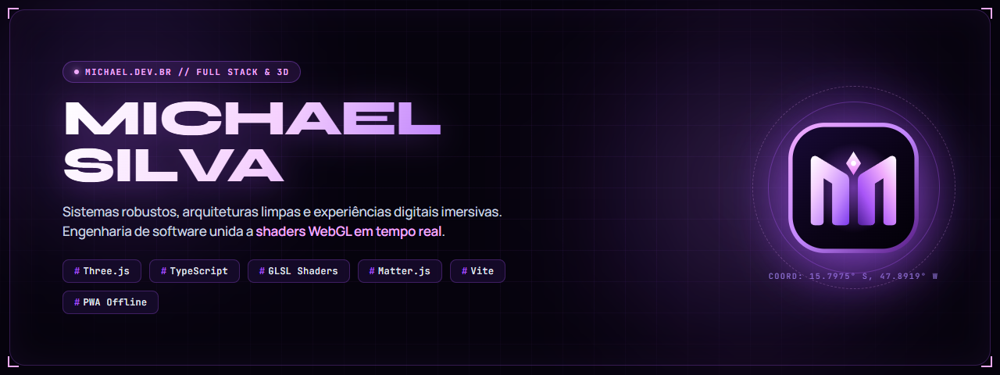

<div align="center">

  

  <br />
  <br />

  # Michael Silva — Portfólio 3D Interativo

  **Desenvolvedor Full Stack & Analista de Sistemas**  
  *Sistemas robustos, arquiteturas limpas e experiências digitais imersivas.*

  <br />

  [](https://michael.dev.br)
  [](https://www.typescriptlang.org/)
  [](https://threejs.org/)
  [](https://vitejs.dev/)
  [](https://developer.mozilla.org/pt-BR/docs/Web/Progressive_web_apps)
  [-emerald?style=for-the-badge&logo=shield)](https://github.com/Lettify/michael.dev.br)

</div>

---

## Visão Geral

Este repositório contém o código-fonte do portfólio oficial de **Michael Silva** ([michael.dev.br](https://michael.dev.br)).

O projeto foi concebido para unir **computação gráfica 3D em tempo real** e **design editorial futurista** à engenharia de software de alta performance. Combina shaders customizados, física de partículas 2D, acessibilidade, suporte offline completo e uma pontuação de segurança de **Grau A+** no Mozilla Observatory / OWASP.

---

## Principais Destaques e Funcionalidades

### 1. WebGL e Shaders Cinematográficos 3D
- **Pipeline de Pós-Processamento:** Integração de `EffectComposer` com `UnrealBloomPass` para bloom seletivo em orbes e poeira estelar cósmica.
- **Distorção Cromática Reativa:** Shader customizado de aberração cromática e curvatura óptica de lente (*cinematic chromatic warp*) reativo à velocidade de rolagem do usuário.
- **Metamorfose Geométrica:** O universo WebGL se transforma dinamicamente através do scroll (Esfera Cósmica -> Torus Interativo -> Malha Topográfica -> Rei do Xadrez -> Orbe Gravitacional).
- **Spikes de Difração Estelar:** Efeito de difração óptica de 4 pontas nas estrelas cósmicas com dispersão iridescente.

### 2. Física Interativa 2D (Matter.js)
- Sandbox interativo onde as pílulas de tecnologias da *Tech Stack* possuem gravidade, massa, colisões e restituição elástica reais, permitindo que o visitante as arraste, jogue e reorganize.

### 3. Internacionalização Instantânea (i18n)
- Suporte nativo e instantâneo a **Português (BR)** e **English (US)**.
- Alternador reativo no cabeçalho e menu fullscreen, com persistência via `localStorage` e detecção automática do idioma do navegador.
- Preservação de alinhamento tipográfico e quebra de linha em ambos os idiomas.

### 4. PWA e Navegação Offline (0ms)
- **Instalável:** Configurado como aplicativo *standalone* no Android, iOS, Windows e macOS via manifesto PWA (`manifest.webmanifest`).
- **Service Worker Inteligente (`sw.js`):**
  - **Navegação (HTML):** *Network-First* com fallback transparente para o cache.
  - **Assets Estáticos (JS, CSS, Fontes WOFF2, Texturas):** *Stale-While-Revalidate* para carregamento em 0ms com atualização silenciosa em segundo plano.
- **Indicadores de Conexão:** Notificações de status online/offline e botão nativo de instalação no menu.

### 5. Blindagem de Segurança (Grau A+ / 98 de 100)
- **Cabeçalhos HTTP Hardened ([`vercel.json`](./vercel.json)):**
  - `Content-Security-Policy (CSP)` restritivo.
  - `X-Frame-Options: DENY` (anti-clickjacking).
  - `Strict-Transport-Security (HSTS)` de 2 anos com `preload`.
  - `X-Content-Type-Options: nosniff`.
  - `Permissions-Policy` bloqueando câmera, microfone e geolocalização.
- **API Serverless Blindada ([`api/contact.js`](./api/contact.js)):** Rate-limiting em memória por IP, mitigação de menções no Discord (`allowed_mentions`), honeypot anti-spam e validação de origem (CSRF).
- **Zero Sinks Vulneráveis:** 100% livre de DOM XSS e dependências auditadas com 0 vulnerabilidades (`npm audit`).

### 6. Gerenciamento Adaptativo de Energia (Modo Eco)
- Monitoramento contínuo da API de Bateria (`navigator.getBattery`).
- Redução automática da taxa de quadros e desligamento de renderizadores sob bateria fraca, dispositivos de baixa potência ou perda de foco da aba.

### 7. Identidade Visual Proprietária (The Hyper-Geometric M-Crest)
- Favicon concebido com geometria matemática pura em SVG, com asas chanfradas simétricas em 45°/60°, corredor de ascensão e singularidade estelar.
- Pacote multi-resolução integrado (`.ico` nativo 16/32/48, PNGs, Apple Touch Icon e PWA maskable).

---

## Stack Tecnológica

| Categoria | Tecnologias Utilizadas |
| :--- | :--- |
| **Linguagem & Runtime** | [TypeScript](https://www.typescriptlang.org/) (Strict Mode), [Node.js](https://nodejs.org/) |
| **Build & Bundler** | [Vite 6+](https://vitejs.dev/) (Compilação ultraveloz < 400ms) |
| **Renderização 3D & WebGL** | [Three.js](https://threejs.org/), GLSL Custom Shaders, EffectComposer |
| **Física 2D** | [Matter.js](https://brm.io/matter-js/) |
| **Animações & Scroll** | [GSAP 3](https://greensock.com/gsap/) (ScrollTrigger), [Lenis](https://lenis.darkroom.engineering/) (Smooth Scroll) |
| **PWA & Offline** | Web App Manifest, Service Workers Cache API |
| **Tipografia & Estilo** | Modern CSS (Design Tokens, Clamp responsivo), JetBrains Mono, Syne, Manrope |
| **Infraestrutura & Backend** | [Vercel Serverless Functions](https://vercel.com/), Discord Webhooks, Resend API |
| **Métricas & Telemetria** | Vercel Analytics, Vercel Speed Insights |

---

## Arquitetura de Pastas

```bash
michael.dev.br/
├── api/                     # Funções Serverless (Vercel Backend)
│   └── contact.js           # Rota segura de envio de mensagens com rate-limiting
├── public/                  # Assets estáticos servidos na raiz
│   ├── favicon.svg          # Favicon vetorial "The Hyper-Geometric M-Crest"
│   ├── favicon.ico          # Ícone multi-resolução nativo (16x16, 32x32, 48x48)
│   ├── manifest.webmanifest # Manifesto da PWA
│   ├── sw.js                # Service Worker com cache híbrido e modo offline
│   ├── repo-banner.png      # Banner oficial do repositório GitHub (1280x480)
│   ├── og-cover.png         # OpenGraph cover para redes sociais
│   └── sitemap.xml          # Mapa do site para SEO
├── scripts/                 # Scripts de automação e utilitários de build
│   └── build_final_favicon.py # Pipeline de geração das resoluções de ícones
├── src/                     # Código-fonte principal
│   ├── gl/                  # Pipeline WebGL e Three.js
│   │   ├── scene.ts         # Cena 3D, EffectComposer, Bloom e Shaders
│   │   ├── shaders.ts       # Shaders customizados em GLSL
│   │   └── shapes.ts        # Geometrias matemáticas das formas cósmicas
│   ├── i18n/                # Internacionalização
│   │   ├── index.ts         # Motor de tradução e reatividade de idioma
│   │   └── translations.ts  # Dicionários em Português e Inglês
│   ├── ui/                  # Módulos de interface e interatividade
│   │   ├── interactions.ts  # Cursor magnético, efeito tilt 3D e proximidade
│   │   ├── personal-hud.ts  # HUD bento de especificações pessoais dinâmicas
│   │   ├── physics.ts       # Sandbox de física 2D com Matter.js
│   │   ├── power.ts         # Gerenciador adaptativo de economia de energia
│   │   ├── pwa.ts           # Registro de Service Worker e eventos online/offline
│   │   ├── sound.ts         # Efeitos sonoros sintetizados via Web Audio API
│   │   └── split.ts         # Desmembramento tipográfico para animações
│   ├── styles/              # Folhas de estilo modularizadas
│   │   └── main.css         # CSS global com tokens cósmicos e tipografia
│   ├── data.ts              # Dados de projetos, estudos de caso e stack
│   └── main.ts              # Ponto de entrada, orquestração e animações
├── index.html               # Estrutura HTML semântica com tags PWA e SEO
├── vercel.json              # Cabeçalhos HTTP de segurança rigorosos (CSP, HSTS)
├── tsconfig.json            # Configurações do compilador TypeScript
└── package.json             # Dependências e scripts do projeto
```

---

## Como Executar Localmente

### Pré-requisitos
- [Node.js](https://nodejs.org/) (versão 18.0 ou superior recomendada)
- [npm](https://www.npmjs.com/) ou [pnpm](https://pnpm.io/) / [yarn](https://yarnpkg.com/)

### Passo a Passo

1. **Clone o repositório:**
   ```bash
   git clone https://github.com/Lettify/michael.dev.br.git
   cd michael.dev.br
   ```

2. **Instale as dependências:**
   ```bash
   npm install
   ```

3. **Inicie o servidor de desenvolvimento:**
   ```bash
   npm run dev
   ```
   O site estará acessível em `http://localhost:5173`.

4. **Verificação de tipos (Typecheck):**
   ```bash
   npm run typecheck
   ```

5. **Compilação para Produção (Build):**
   ```bash
   npm run build
   ```
   Os arquivos otimizados serão gerados na pasta `dist/`.

6. **Visualização do Build de Produção:**
   ```bash
   npm run preview
   ```

---

## Variáveis de Ambiente (Opcional para API)

Para habilitar o envio direto do formulário de contato via Discord Webhook ou e-mail (Resend), configure as seguintes variáveis no painel da Vercel ou em um arquivo `.env`:

```env
# URL do Webhook do canal no Discord
DISCORD_WEBHOOK_URL="https://discord.com/api/webhooks/..."

# Chave de API do Resend (opcional, para envio de e-mails transacionais)
RESEND_API_KEY="re_..."

# E-mail de destino para notificações
CONTACT_EMAIL="contato@michael.dev.br"
```

> **Nota:** Caso as variáveis não estejam configuradas, o formulário possui um fallback inteligente e automático que abre o cliente de e-mail padrão do usuário pré-formatado via `mailto:`, garantindo que nenhuma mensagem seja perdida.

---

## Easter Eggs do Terminal Cósmico

Ao navegar pelo site, você pode digitar palavras secretas no teclado para acionar reações especiais no universo:

- Digite `bloom` ou `cine`: Alterna os **Shaders Cinematográficos de Bloom** em tempo real.
- Digite `xadrez`: Transforma a forma 3D na peça do **Rei do Xadrez**.
- Digite `lua`: Converte a forma cósmica no orbe de **Lua Cheia**.
- Digite `eco`: Ativa ou desativa manualmente o **Modo de Economia de Energia**.
- Digite `roxo`: Dispara uma explosão cósmica roxa na tela.

---

## Autor

**Michael Silva** (`Lettify`)  
*Desenvolvedor Full Stack & Analista de Sistemas* — Brasília, DF, Brasil

- **Website:** [michael.dev.br](https://michael.dev.br)
- **LinkedIn:** [linkedin.com/in/michael-felipe-ss](https://www.linkedin.com/in/michael-felipe-ss/)
- **GitHub:** [@Lettify](https://github.com/Lettify)
- **E-mail:** [contato@michael.dev.br](mailto:contato@michael.dev.br)

---

## Licença

Este projeto é disponibilizado sob a licença [MIT](./LICENSE) — sinta-se à vontade para explorar o código e se inspirar para seus próprios projetos.

<br />

<div align="center">
  <sub>Projetado &amp; Desenvolvido por Michael Silva com Three.js, GSAP e muito roxo. © 2026.</sub>
</div>
